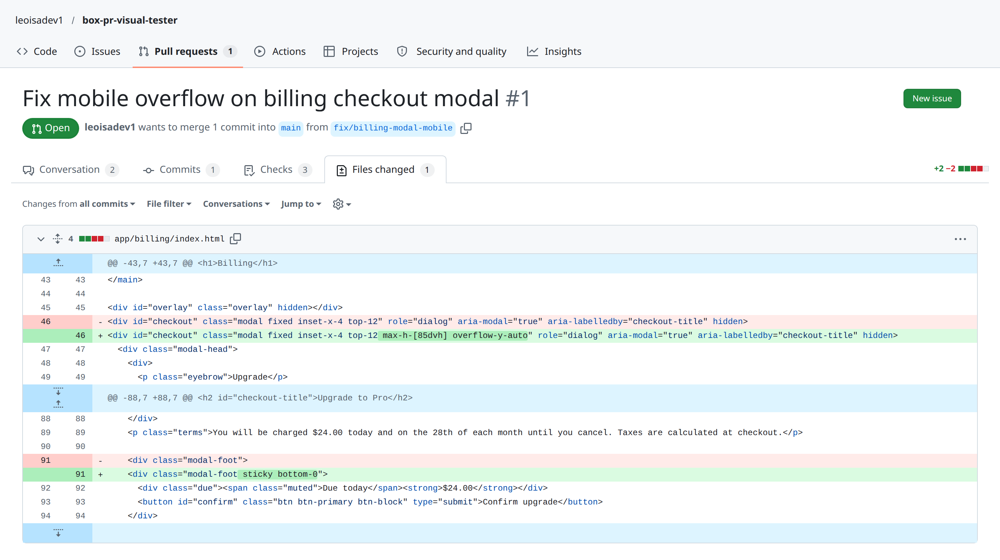
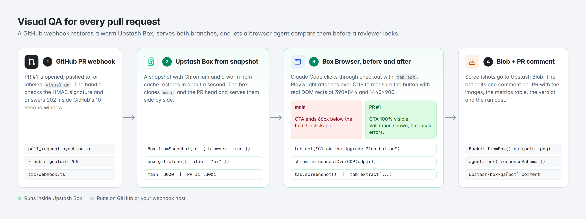
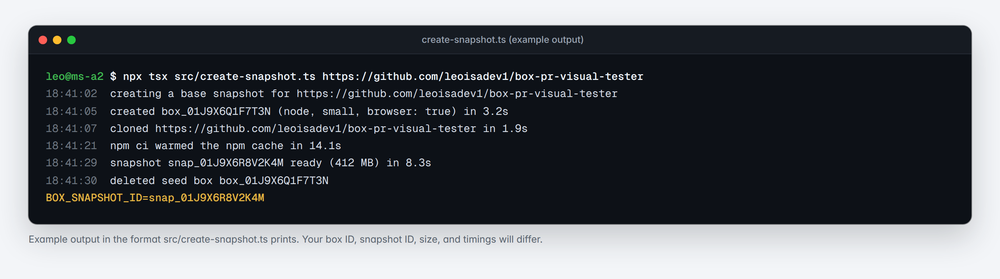
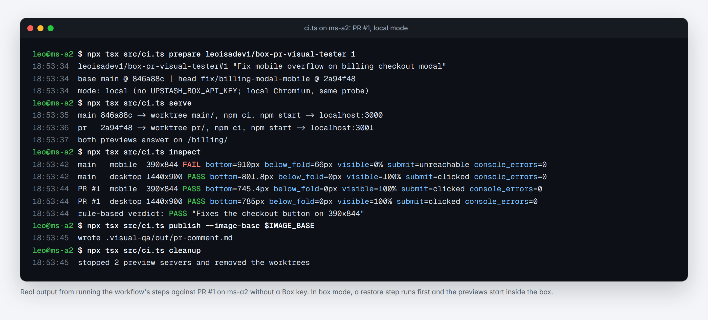
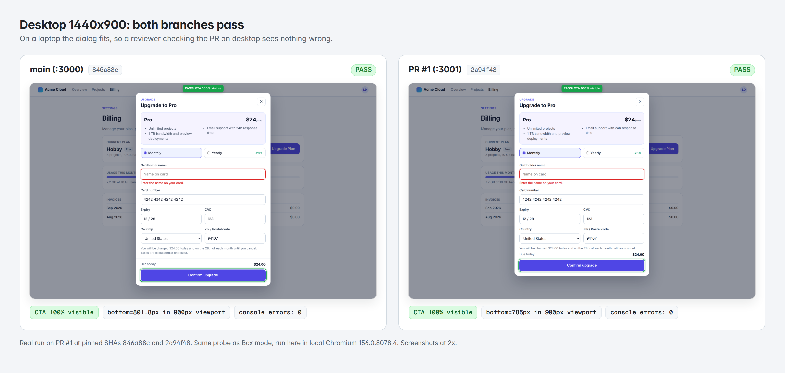
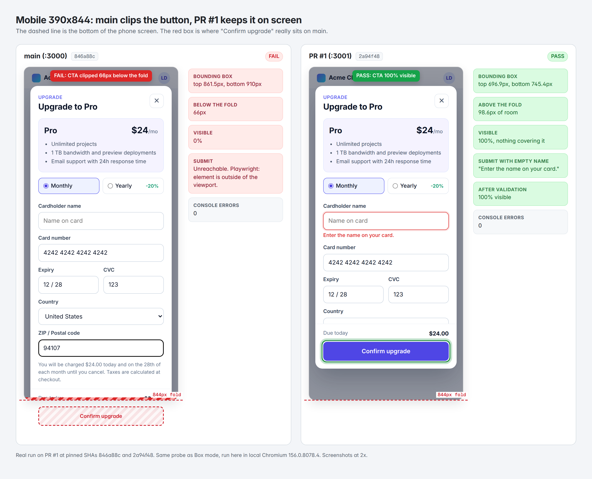
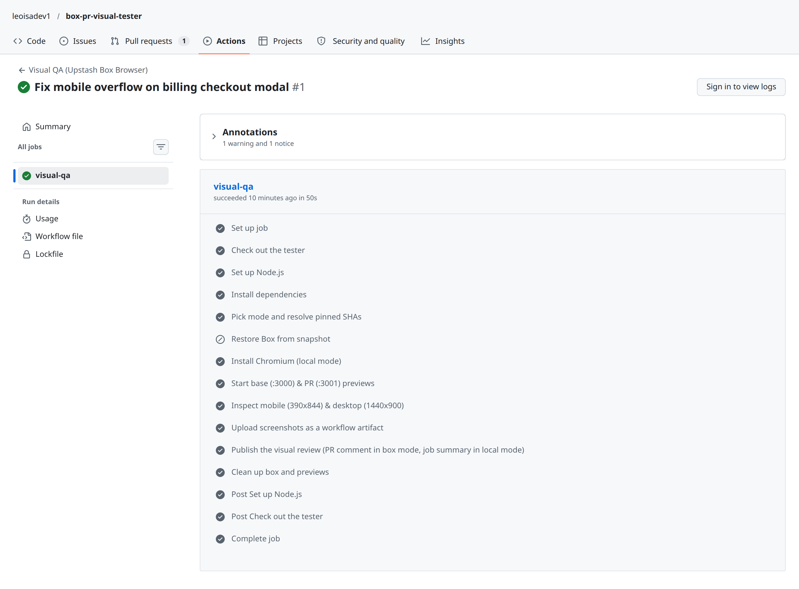
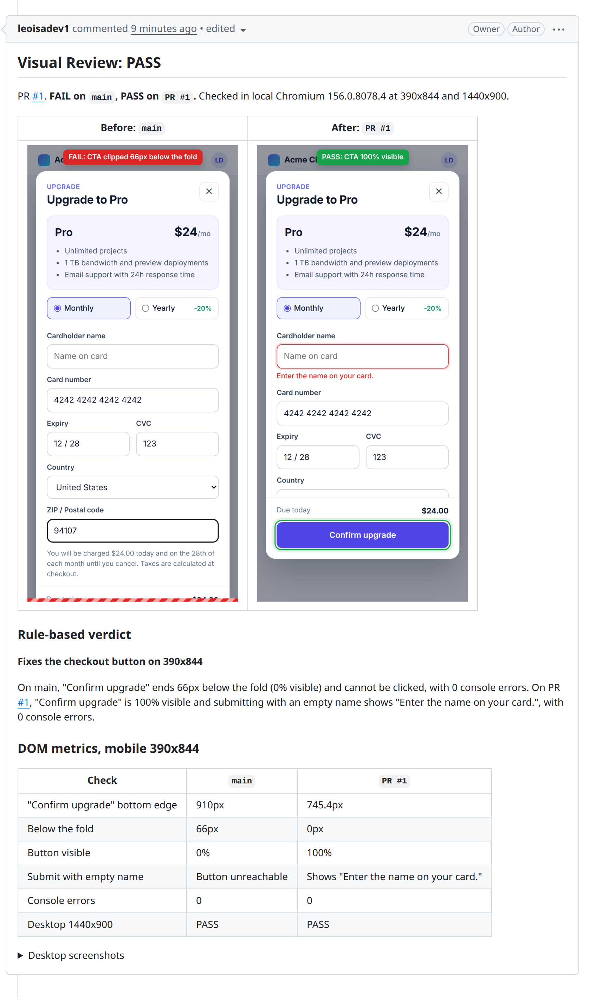

A couple of weeks ago I approved a two-line CSS pull request in about ten seconds. CI was green, TypeScript was happy, and the diff touched two Tailwind classes on a modal. Later that day I opened the billing page on my phone and tried to upgrade a test account. The "Confirm upgrade" button sat 66 pixels below the bottom of the screen, and because the open modal locked body scroll, there was no way to scroll down and tap it.

Git diffs are terrible at showing layout bugs. I also hate checking out a teammate's branch locally, running `npm install`, starting a dev server, and resizing Chrome DevTools just to verify that a dialog still fits on an iPhone screen. When I'm tired or moving fast, I skip that step.

So I built a small bot that does the annoying part for me on every pull request. In this post I want to show you how I built it with [Upstash Box](https://upstash.com/docs/box), Box Browser, Playwright, and [Upstash Blob](https://upstash.com/docs/blob).

The whole project is open source at [leoisadev1/box-pr-visual-tester](https://github.com/leoisadev1/box-pr-visual-tester), and you can see the bot's actual comment on [PR #1](https://github.com/leoisadev1/box-pr-visual-tester/pull/1). Here is a 28-second clip of the full loop from opening the PR to the review comment on GitHub:

<video src="./artifacts/box-pr-tester-demo.mp4" controls muted playsInline />

## The two-line diff that started this

Here is the `Files changed` tab from [PR #1](https://github.com/leoisadev1/box-pr-visual-tester/pull/1/files) in the demo repo. It swaps two lines in `app/billing/index.html`:



If you read those two lines in GitHub, you have to run a browser layout engine in your head. On `main`, the checkout dialog uses `fixed inset-x-4 top-12` with no height cap. On a desktop monitor that works fine, because 900 pixels of vertical height is plenty of room for the plan summary and the card inputs. On a 390x844 phone screen, the dialog content pushes the footer past the bottom edge of the viewport while the backdrop locks page scrolling.

PR #1 fixes that by adding `max-h-[85dvh] overflow-y-auto` to the dialog and `sticky bottom-0` to the footer. What I wanted was a bot that opens both branches in a real browser, tries to use the modal at desktop and mobile sizes, and replies on the PR with screenshots and exact pixel measurements.

## What runs when a PR opens

When you open or push to a pull request, the bot runs four steps:



1. GitHub triggers the run through a webhook in `src/webhook.ts` or a GitHub Actions workflow in `.github/workflows/visual-qa.yml`.
2. The runner restores an Upstash Box from a pre-built snapshot, checks out the base commit and the PR commit into two folders, and starts both dev servers on `:3000` and `:3001`.
3. Inside the Box's built-in Chromium, `tab.act` clicks through the upgrade flow while Playwright attaches over the Chrome DevTools Protocol via `box.browser.cdpUrl()` to measure the submit button at `1440x900` and `390x844`.
4. Claude Code turns those measurements into a short verdict, `@upstash/blob` uploads the before and after screenshots to a public bucket, and the bot edits its comment on the PR.

I kept the repo small so each step is easy to read and reuse:

```text
src/
  create-snapshot.ts   one-time script that builds the base Box snapshot
  box-stages.ts        restore, serve both branches, inspect, verdict, upload
  probe.ts             Playwright DOM probe for fold, clipping, and validation
  report.ts            Zod verdict schema, fallback verdict, PR comment markdown
  github.ts            SHA-pinned PR refs and comment upsert
  pr-visual-tester.ts  single-process CLI runner
  ci.ts                step runner used by GitHub Actions
  webhook.ts           HMAC-verified webhook with a per-PR queue
app/billing/           the demo billing page with the mobile modal bug
```

If you want to run it on your own repo, clone the project and install dependencies:

```bash
git clone https://github.com/leoisadev1/box-pr-visual-tester
cd box-pr-visual-tester
npm install
```

You need `UPSTASH_BOX_API_KEY` from the Upstash Console and a `GITHUB_TOKEN` that can read your repo and comment on PRs. To display screenshots inline in GitHub comments, also set `UPSTASH_BLOB_TOKEN` for a public Upstash Blob bucket.

## Taking a base snapshot so PR checks boot fast

Nobody wants a PR check that spends a full minute installing Chromium and downloading npm packages on every push. Upstash Box lets you configure a container once, warm up the package cache, and save the disk state with `box.snapshot()`.

Here is `createBaseSnapshot` in `src/box-stages.ts`:

```ts
// src/box-stages.ts
export async function createBaseSnapshot({ env, repoUrl, log }: { env: Env; repoUrl: string; log: Log }): Promise<string> {
  const seed = await Box.create({
    runtime: "node",
    size: "small",
    browser: true,
    agent: agentConfig(env),
    git: { token: env.GITHUB_TOKEN },
  });
  try {
    await seed.git.clone({ repo: repoUrl, folder: "seed", depth: 1 });
    await seed.cd("seed");
    await mustSucceed(seed.exec.command("npm ci --no-audit --no-fund"));
    const snapshot = await seed.snapshot({ name: "pr-visual-base" });
    return snapshot.id;
  } finally {
    await seed.delete();
  }
}
```

Passing `browser: true` gives the Box a headless Chromium instance right out of the gate. We run `create-snapshot.ts` once and save the snapshot ID it prints at the end:

```bash
npx tsx src/create-snapshot.ts https://github.com/leoisadev1/box-pr-visual-tester
```



When `package-lock.json` changes down the road, you can re-run the script to refresh the snapshot. Even if you forget, `npm ci --prefer-offline` still works and only fetches the packages that changed.

## Running both branches side by side in one Box

Most visual regression tools compare a screenshot from your PR against a baseline image saved from an earlier build. I never liked that setup because baseline images go stale constantly, and a harmless copy change or timestamp breaks the diff.

Since an Upstash Box is a full Linux container, we can run both versions of the app at the same time on two ports and compare them live. `serveBranches` clones the base branch into `main/` on port `3000` and the PR branch into `pr/` on port `3001`:

```ts
// src/box-stages.ts
for (const branch of BRANCHES) {
  const isHead = branch.key === "after";
  const sha = isHead ? pr.headSha : pr.baseSha;
  await box.git.clone({
    repo: isHead ? pr.headCloneUrl : pr.baseCloneUrl,
    branch: isHead ? pr.headRef : pr.baseRef,
    folder: branch.folder,
    depth: 1,
  });
  await box.cd(branch.folder);
  await mustSucceed(
    box.exec.command(`git fetch --depth 1 origin ${sha} && git checkout --detach ${sha} && test "$(git rev-parse HEAD)" = ${sha}`),
  );
  await mustSucceed(box.exec.command("npm ci --prefer-offline --no-audit --no-fund"));
  await mustSucceed(box.exec.command(`PORT=${branch.port} nohup ${env.PREVIEW_START} > /tmp/${branch.folder}.log 2>&1 &`));
  await box.cd("..");
}
```

One detail here saved me from a subtle race condition. If someone pushes a second commit while the Box is still booting, cloning the branch name alone will grab the newer commit and post the result under the older SHA. That is why the script fetches the exact 40-character commit SHA from the webhook event, detaches `HEAD` at that SHA, and verifies `git rev-parse HEAD` before starting the server.

Because the browser lives inside the same Box, both apps are reachable on `http://localhost:3000` and `http://localhost:3001` without exposing public preview tunnels. Here is what the terminal log looks like when the runner boots both worktrees and probes PR #1:



## Mixing Box Browser actions with Playwright over CDP

When I started writing the browser check, I ran into an annoying tradeoff. If you write the whole test with CSS selectors in Playwright, someone renames a button class next week and your test breaks. If you ask a vision model to look at a screenshot and guess whether the layout is broken, it will confidently tell you a clipped button looks great.

Box Browser lets you combine both approaches on the exact same Chromium tab. I use `tab.act()` in plain English to open the upgrade modal, so the navigation step doesn't care about class names. Then I connect Playwright to the Box's Chromium over `box.browser.cdpUrl()` to read the exact DOM geometry:

```ts
// src/box-stages.ts
const browser = await chromium.connectOverCDP(await box.browser.cdpUrl());
const tab = await box.browser.tab.create(url, { waitUntil: "networkidle" });
const page = findPage(browser, url);

const openCheckout = async () => {
  try {
    const result = await tab.act("Click the Upgrade Plan button");
    if (result.success) return;
  } catch {}
  await page.getByRole("button", { name: "Upgrade Plan" }).click();
};

const cdp = await emulate(page, { name: "mobile", width: 390, height: 844 });
try {
  const report = await inspectCheckout({ page, viewport, openCheckout });
  await annotate(page, report);
  const png = await tab.screenshot();
} finally {
  await cdp.detach();
}
```

Keep the CDP session open until after you take the screenshot when using `connectOverCDP`. In my first attempt I detached the CDP session right after setting the viewport, and Chromium immediately reset the tab back to `1280x720` before the probe ran.

Once the modal is open, `inspectCheckout` in `src/probe.ts` fills the card number, expiry, and CVC, leaves the cardholder name blank on purpose, and tries to click the submit button. To figure out how much of the button is actually visible on screen, it walks up the DOM tree from the button to the fixed modal container:

```ts
// src/probe.ts
const visiblePercent = await page.$eval("#checkout button[type=submit]", (button) => {
  const r = button.getBoundingClientRect();
  let top = Math.max(r.top, 0);
  let bottom = Math.min(r.bottom, window.innerHeight);
  for (let el = button.parentElement; el && el !== document.body; el = el.parentElement) {
    const style = getComputedStyle(el);
    if (style.overflowY !== "visible") {
      const clip = el.getBoundingClientRect();
      top = Math.max(top, clip.top);
      bottom = Math.min(bottom, clip.bottom);
    }
    if (style.position === "fixed") break;
  }
  return Math.round((Math.max(0, bottom - top) / r.height) * 1000) / 10;
});
```

That `if (style.position === "fixed") break;` line is there because of a bug I hit while writing the probe. When the modal opens, `document.body` gets `overflow: hidden` to lock background scrolling. A loop that walks all the way to `<body>` treats the locked body as a clipping parent and claims the button is 0% visible even when it sits right in the middle of the screen. Stopping at the fixed dialog gives you the real visibility percentage.

Here is what the probe captures at `1440x900` desktop width. Both `main` and `PR #1` render the full modal above the 900px fold, and both show `"Enter the name on your card."` when submitting with an empty name:



And here is the `390x844` mobile capture. On `main`, the submit button starts at `861.5px` and ends at `910px`, which puts it `66px` past the `844px` bottom edge of the screen. On `PR #1`, the sticky footer keeps the button at `745.4px` with `98.6px` of breathing room above the fold:



After Playwright takes its measurements, I also call `tab.extract()` with a small Zod schema so the browser model reads the visible button label and validation error from the page as a second check:

```ts
const AgentRead = z.object({
  primaryButtonLabel: z.string(),
  validationMessage: z.string().nullable(),
});
const agentRead = await tab
  .extract(
    "Read the checkout dialog. Return the primary button's label and the validation message under the cardholder name, or null if there is none.",
    AgentRead,
  )
  .catch(() => null);
```

## Turning the numbers into a PR verdict with Claude Code

Raw JSON coordinates are great for assertions, but when I'm reviewing a PR on GitHub I want a two-sentence summary at the top of the comment telling me what changed.

Since the Box already has Claude Code configured, `computeVerdict` passes the before and after measurements to `box.agent.run()` with a Zod `responseSchema`:

```ts
// src/report.ts
export const VerdictSchema = z.object({
  status: z.enum(["pass", "fail"]),
  headline: z.string().describe("One sentence, under 90 characters."),
  summary: z.string().describe("Two or three sentences a reviewer can act on."),
  regressions: z.array(z.string()).describe("Problems the PR introduces. Empty when there are none."),
});

// src/box-stages.ts
const run = await box.agent.run({
  prompt: buildVerdictPrompt({ prNumber: pr.number, title: pr.title, before, after, agentRead }),
  responseSchema: VerdictSchema,
  timeout: 120_000,
});
const verdict = run.result;
```

The prompt tells Claude Code to quote the exact pixel coordinates from the probe instead of guessing from the screenshots. And if the model call ever times out or you run the script without an LLM key, `ruleBasedVerdict()` in `src/report.ts` computes the same pass/fail object directly from the probe numbers so your CI check still finishes.

## Uploading screenshots to Upstash Blob and updating the PR comment

GitHub PR comments cannot render local file paths from inside a container, so the runner uploads the annotated PNGs to a public Upstash Blob bucket keyed by the PR number and head commit SHA:

```ts
// src/box-stages.ts
const bucket = new Bucket({ token });
const blob = await bucket.put(
  `visual-qa/${pr.repo}/pr-${pr.number}/${pr.headSha}/before-mobile.png`,
  png,
  { contentType: "image/png", cache: "immutable" },
);
if (!blob.url) {
  throw new Error("The Blob bucket is private. GitHub needs public image URLs; make the bucket public.");
}
```

Then `upsertComment()` in `src/github.ts` posts the markdown report to the pull request. Rather than leaving a new comment on every `git push` and burying the review thread in bot spam, it prefixes the comment with `<!-- upstash-box-visual-review -->` and edits its existing comment in place. It also checks that the existing comment was authored by the bot's own GitHub login before editing it.

## Wiring it into GitHub Actions or a webhook

You can trigger the tester in two ways. If you want zero extra servers to manage, `.github/workflows/visual-qa.yml` runs the stages directly in GitHub Actions:

```yaml
on:
  pull_request:
    types: [opened, synchronize, reopened, labeled]

concurrency:
  group: visual-qa-${{ github.event.pull_request.number }}
  cancel-in-progress: true

jobs:
  visual-qa:
    runs-on: ubuntu-24.04
    env:
      UPSTASH_BOX_API_KEY: ${{ secrets.UPSTASH_BOX_API_KEY }}
      BOX_SNAPSHOT_ID: ${{ secrets.BOX_SNAPSHOT_ID }}
      UPSTASH_BLOB_TOKEN: ${{ secrets.UPSTASH_BLOB_TOKEN }}
      GITHUB_TOKEN: ${{ secrets.GITHUB_TOKEN }}
    steps:
      - uses: actions/checkout@v7
        with:
          ref: ${{ github.event.pull_request.base.sha }}
      - uses: actions/setup-node@v7
        with: { node-version: 22, cache: npm }
      - run: npm ci --no-audit --no-fund
      - name: Pick mode and resolve pinned SHAs
        id: prepare
        run: npx tsx src/ci.ts prepare
      - name: Restore Box from snapshot
        if: steps.prepare.outputs.mode == 'box'
        run: npx tsx src/ci.ts restore
      - name: Install Chromium (local mode)
        if: steps.prepare.outputs.mode == 'local'
        run: npx playwright-core install --with-deps chromium
      - name: Start base (:3000) & PR (:3001) previews
        run: npx tsx src/ci.ts serve
      - name: Inspect mobile (390x844) & desktop (1440x900)
        run: npx tsx src/ci.ts inspect
      - uses: actions/upload-artifact@v7
        with: { name: "visual-qa-pr-${{ github.event.pull_request.number }}", path: .visual-qa/out/ }
      - name: Publish the visual review
        run: npx tsx src/ci.ts publish
      - name: Clean up box and previews
        if: always()
        run: npx tsx src/ci.ts cleanup
```

Notice `ref: ${{ github.event.pull_request.base.sha }}` on the checkout step. Checking out the runner script from `base.sha` means an untrusted PR cannot edit `src/ci.ts` to print your secrets or fake a passing score. The workflow also supports a local Chromium fallback when `UPSTASH_BOX_API_KEY` is absent, which is handy for PRs opened from external forks where GitHub withholds repository secrets.

Here is the workflow run on [PR #1](https://github.com/leoisadev1/box-pr-visual-tester/actions/runs/20791843219), which finished in 50 seconds:



If you prefer running your own webhook service instead of GitHub Actions, `src/webhook.ts` verifies GitHub's `x-hub-signature-256` header and keeps a tiny in-memory queue per PR. When a developer pushes three commits in twenty seconds, it finishes the active run, skips the middle commit, and only runs the newest SHA so an older run never overwrites a newer comment.

## The comment that lands on the PR

Here is the actual comment the bot posted on [PR #1](https://github.com/leoisadev1/box-pr-visual-tester/pull/1#issuecomment-3457964759):



Right inside the PR conversation, any reviewer can see the red dashed `844px` fold line on `main`, the green outline around the fixed button on `PR #1`, and the comparison table:

| Mobile 390x844 | `main` | `PR #1` |
| --- | --- | --- |
| "Confirm upgrade" bottom edge | 910px | 745.4px |
| Below the fold | 66px | 0px |
| Button visible | 0% | 100% |
| Submit with empty name | Button unreachable | Shows "Enter the name on your card." |
| Console errors | 0 | 0 |
| Desktop 1440x900 | PASS | PASS |

## What a run costs

Upstash Box bills active CPU time at $0.10 per CPU-hour, and most of a visual QA run is spent waiting on network I/O and browser paint rather than pegging the CPU. A few seconds of active compute costs a fraction of a cent, so almost the entire cost of a run in Box mode is the Claude Code token usage for `tab.act`, `tab.extract`, and the short verdict summary, which usually comes out under a cent or two with Sonnet. And because the Box is deleted in the `finally` block as soon as the comment is posted, you pay nothing between PRs.

## Try it on your own repo

You can grab the full code at [leoisadev1/box-pr-visual-tester](https://github.com/leoisadev1/box-pr-visual-tester) and inspect the live run on [PR #1](https://github.com/leoisadev1/box-pr-visual-tester/pull/1). To point it at your own app, change the target URL and selector in `src/probe.ts`, run `npx tsx src/create-snapshot.ts <your-repo-url>` once, and drop `.github/workflows/visual-qa.yml` into your repository.
