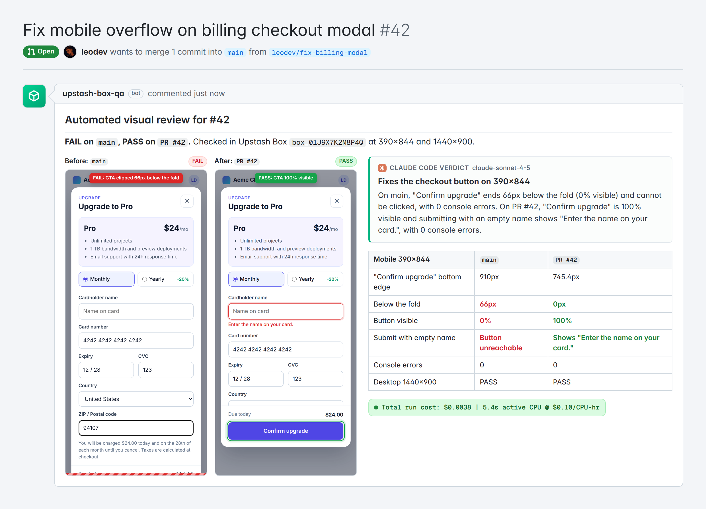

Unit tests don't see the screen. A pull request can pass every check and still ship a checkout dialog whose "Confirm upgrade" button sits below the fold on a phone, where nobody can tap it.

In this post we'll build a small agent that catches that class of bug on every PR. When a pull request opens, a GitHub webhook restores an [Upstash Box](https://upstash.com/docs/box) from a snapshot, serves the base branch and the PR side by side, and lets Claude Code drive the box's built-in Chromium through the flow. Playwright attaches to the same browser to take exact DOM measurements, and the bot posts one comment with before and after screenshots, a metrics table, and a verdict.

<video src="./artifacts/box-pr-tester-demo.mp4" controls muted playsInline />

The agent itself is about 1,000 lines of TypeScript in five files, built on `@upstash/box` 0.7.10, `@upstash/blob` 0.0.12, and `playwright-core`.


## The bug we want to catch

Our example app has a billing page with an "Upgrade Plan" button that opens a checkout dialog. On `main`, the dialog is positioned with `fixed inset-x-4 top-12` and has no height limit. On a 390x844 phone viewport, its content runs past the bottom of the screen. Body scroll is locked while the dialog is open, so the user can't reach the button.

PR #42 fixes it with two class changes:

```diff
- <div id="checkout" class="modal fixed inset-x-4 top-12" role="dialog">
+ <div id="checkout" class="modal fixed inset-x-4 top-12 max-h-[85dvh] overflow-y-auto" role="dialog">
...
- <div class="modal-foot">
+ <div class="modal-foot sticky bottom-0">
```

The dialog now stops at 85% of the dynamic viewport height and scrolls internally, and the footer with the button stays pinned to its bottom edge. We want an agent to confirm that the fix works, with numbers, before a reviewer opens the PR.

## What you need

- An Upstash Box API key in `UPSTASH_BOX_API_KEY`
- An Upstash Blob token in `UPSTASH_BLOB_TOKEN` for a **public** bucket, because GitHub has to load the screenshots
- A GitHub token in `GITHUB_TOKEN` that can read the repository and comment on pull requests
- Optionally, your own Anthropic key in `ANTHROPIC_API_KEY`. Without it, the box uses the Upstash-managed key.

```bash
npm install @upstash/box @upstash/blob playwright-core zod
```

## Step 1: make a base snapshot once

Every PR run starts from a snapshot instead of a cold box. The seed box has Chromium (`browser: true`), a shallow clone of the repo, and a warm npm cache, so later installs in a fresh checkout mostly hit the cache.

```ts
import { Agent, Box, BoxApiKey, ClaudeCode } from "@upstash/box";

const agent = {
  harness: Agent.ClaudeCode,
  model: ClaudeCode.Sonnet_4_5,
  apiKey: process.env.ANTHROPIC_API_KEY ?? BoxApiKey.UpstashKey,
};

export async function createBaseSnapshot(repoUrl: string): Promise<string> {
  const seed = await Box.create({
    runtime: "node",
    size: "small",
    browser: true,
    agent,
    git: { token: process.env.GITHUB_TOKEN! },
  });
  try {
    await seed.git.clone({ repo: repoUrl, folder: "seed", depth: 1 });
    await seed.cd("seed");
    await seed.exec.command("npm ci");
    const snapshot = await seed.snapshot({ name: "pr-visual-base" });
    return snapshot.id;
  } finally {
    await seed.delete();
  }
}
```

Save the returned ID as `BOX_SNAPSHOT_ID`. Re-run this when your lockfile changes a lot; stale caches only make `npm ci` slower, not wrong.

## Step 2: serve both branches in one box

For each PR, restore the snapshot, clone the base branch into `main/` and the PR head into `pr/`, and start each on its own port. Cloning the head from `headCloneUrl` keeps PRs from forks working.

Branches move. If someone pushes again while the box is starting, a plain clone of `headRef` tests the newer commit and files the results under the older one. So after cloning, check out the exact SHA the webhook event named.

```ts
const box = await Box.fromSnapshot(process.env.BOX_SNAPSHOT_ID!, {
  size: "small",
  browser: true,
  agent,
  git: { token: process.env.GITHUB_TOKEN! },
});

const branches = [
  { folder: "main", repo: pr.baseCloneUrl, ref: pr.baseRef, sha: pr.baseSha, port: 3000 },
  { folder: "pr", repo: pr.headCloneUrl, ref: pr.headRef, sha: pr.headSha, port: 3001 },
];

for (const b of branches) {
  await box.git.clone({ repo: b.repo, branch: b.ref, folder: b.folder, depth: 1 });
  await box.cd(b.folder);
  await box.exec.command(`git fetch --depth 1 origin ${b.sha} && git checkout --detach ${b.sha}`);
  await box.exec.command("npm ci --prefer-offline --no-audit");
  await box.exec.command(`PORT=${b.port} nohup npm start > /tmp/${b.folder}.log 2>&1 &`);
  await box.cd("..");
}

// Wait until both previews answer.
await box.exec.command(
  "for i in $(seq 1 120); do curl -sf localhost:3000 >/dev/null && curl -sf localhost:3001 >/dev/null && exit 0; sleep 0.25; done; exit 1",
);
```

The browser runs inside the same box, so it reaches both previews on `localhost` with no public URL. The real code in `src/pr-visual-tester.ts` also checks each command's `exitCode` and fails the run early.

## Step 3: let the agent click, and let Playwright measure

This is the core idea. Two tools share one Chromium:

- **Box Browser tabs** do the navigation. `tab.act("Click the Upgrade Plan button")` resolves a plain-English instruction to an element and clicks it, so the test doesn't break when someone renames a CSS class.
- **Playwright over CDP** does the measuring. `box.browser.cdpUrl()` returns an authenticated WebSocket URL, and `chromium.connectOverCDP` attaches to the same tabs.

"Is the button visible?" is a judgment call for a model. "The button's bottom edge is at 910px in an 844px viewport" is a fact, and a DOM probe gets it right every time.

```ts
import { chromium } from "playwright-core";

const browser = await chromium.connectOverCDP(await box.browser.cdpUrl());
const url = "http://localhost:3000/billing";
const tab = await box.browser.tab.create(url, { waitUntil: "networkidle" });
const page = browser.contexts().flatMap((c) => c.pages()).find((p) => p.url().startsWith(url))!;

// tab.screenshot() captures the tab's current viewport, so set it through CDP.
const cdp = await page.context().newCDPSession(page);
await cdp.send("Emulation.setDeviceMetricsOverride", {
  width: 390,
  height: 844,
  deviceScaleFactor: 2,
  mobile: true,
});

const report = await inspectCheckout({
  page,
  viewport: { name: "mobile", width: 390, height: 844 },
  openCheckout: () => tab.act("Click the Upgrade Plan button"),
});
const png = await tab.screenshot();
await cdp.detach(); // only now: detaching drops the emulation
```

Keep that CDP session open until the screenshot is taken. Chromium drops the device override when the session detaches, and the probe reloads the page. We checked this against a CDP-attached Chromium: with an early `detach()`, the "mobile" run actually measured a 1280x720 page at 1x.

`inspectCheckout` lives in `src/probe.ts`. It reloads the page, calls `openCheckout`, fills the card fields, leaves the cardholder name empty, and tries to submit. It returns four things:

- **Where the button is.** `getBoundingClientRect()` on the submit button.
- **How much of it a user can see.** The rect is intersected with the viewport and with every ancestor that clips overflow, up to the fixed dialog.
- **Whether something covers it.** `document.elementFromPoint` at the visible center.
- **What happened on submit.** Either the validation message, or Playwright's own error when the button can't be clicked. After a successful click it measures the button again, because a validation message can push it out of view.

Here is the visibility check, cut down to the vertical axis:

```ts
const visiblePercent = await page.$eval("#checkout button[type=submit]", (button) => {
  const r = button.getBoundingClientRect();
  let top = Math.max(r.top, 0);
  let bottom = Math.min(r.bottom, window.innerHeight);
  // Walk up to the fixed dialog; <body> overflow belongs to the viewport.
  for (let el = button.parentElement; el && el !== document.body; el = el.parentElement) {
    const style = getComputedStyle(el);
    if (style.overflowY !== "visible") {
      const clip = el.getBoundingClientRect();
      top = Math.max(top, clip.top);
      bottom = Math.min(bottom, clip.bottom);
    }
    if (style.position === "fixed") break;
  }
  return Math.round((Math.max(0, bottom - top) / r.height) * 1000) / 10;
});
```

Stop at the fixed dialog, not at `<body>`. The body has `overflow: hidden` while scroll is locked, so a naive walk counts it as a clipping box and reports a perfectly visible button as 0% visible. Our first version did exactly that.

The probe also collects `console` errors and `pageerror` events while it runs. The same function runs at 1440x900 for desktop, and once for each branch.

Finally, `tab.extract()` asks the browser model to read the final state back as typed data. It's a cross-check that the page says what the DOM probe thinks it says, so the real code treats a failed extract as `null` instead of failing the run:

```ts
const AgentRead = z.object({
  primaryButtonLabel: z.string(),
  validationMessage: z.string().nullable(),
});
const agentRead = await tab.extract(
  "Read the checkout dialog. Return the primary button's label and the validation message under the cardholder name, or null if there is none.",
  AgentRead,
);
```

## Step 4: ask Claude Code for the verdict

The measurements go to the Claude Code agent already configured on the box. `responseSchema` makes `run.result` a typed object instead of free text:

```ts
const VerdictSchema = z.object({
  status: z.enum(["pass", "fail"]),
  headline: z.string(),
  summary: z.string(),
  regressions: z.array(z.string()),
});

const run = await box.agent.run({
  prompt: buildVerdictPrompt({ prNumber: pr.number, title: pr.title, before, after, agentRead }),
  responseSchema: VerdictSchema,
  timeout: 120_000,
});
const verdict = run.result; // { status, headline, summary, regressions }
```

The prompt tells the agent to quote pixel numbers from the metrics and not invent its own. Every model step has a fallback, so a model outage never blocks the comment: if `tab.act` fails, the probe clicks the button by its accessible name; if `tab.extract` fails, the cross-check is skipped; if the verdict call fails, `ruleBasedVerdict()` in `src/report.ts` writes a verdict from the measurements alone.

## Step 5: upload screenshots and comment on the PR

Screenshots go to Upstash Blob under a path keyed by the head SHA, so every push gets its own immutable images:

```ts
import { Bucket } from "@upstash/blob";

const bucket = Bucket.fromEnv();
const blob = await bucket.put(`visual-qa/${pr.repo}/pr-${pr.number}/${pr.headSha}/before-mobile.png`, png, {
  contentType: "image/png",
  cache: "immutable",
});
if (!blob.url) throw new Error("The Blob bucket is private. GitHub needs public image URLs.");
```

On a private bucket, `blob.url` is `undefined`, and signed read URLs expire after at most 10 minutes. That's too short for a PR comment, so the code fails loudly instead.

The comment body starts with a hidden marker, `<!-- upstash-box-visual-qa -->`. On the next push, `upsertComment()` pages through the PR's comments, finds the one with that marker **written by the bot's own login** (`GITHUB_BOT_LOGIN`), and edits it instead of posting a new one. Checking the author matters: anyone can paste the marker into their own comment.

Delete the box in a `finally` block so a failed run never leaves one running.

## Step 6: wire up the webhook

`src/webhook.ts` is a plain Node HTTP server. It verifies GitHub's `x-hub-signature-256` HMAC in constant time, answers 202 right away (GitHub gives you 10 seconds), and runs the check in the background.

Two pushes in quick succession are the tricky case. If both runs go at once and the older one finishes last, it overwrites the newer comment with stale results. So the server runs one check per PR at a time, remembers only the newest head SHA that arrived meanwhile, and tells an outdated run not to publish:

```ts
const latest = new Map<string, PullRequestRef>(); // newest event per "owner/repo#number"
const running = new Set<string>();

function enqueue(pr: PullRequestRef): "started" | "queued" {
  const key = prKey(pr);
  latest.set(key, pr);
  if (running.has(key)) return "queued";
  running.add(key);
  void drain(key);
  return "started";
}

async function drain(key: string): Promise<void> {
  try {
    let pr = latest.get(key);
    while (pr) {
      const sha = pr.headSha;
      await visualTestPullRequest({ env, pr, shouldPublish: () => latest.get(key)?.headSha === sha }).catch(
        (err: unknown) => console.error(err),
      );
      const next = latest.get(key);
      if (next?.headSha === sha) {
        latest.delete(key);
        pr = undefined;
      } else {
        pr = next;
      }
    }
  } finally {
    running.delete(key);
  }
}
```

`opened`, `synchronize`, and `reopened` trigger a run. A test with signed payloads returns 401 for a bad signature, 204 for events it ignores, 400 for a malformed payload, and `started` then `queued` for two quick pushes.

Adding the `visual-qa` label re-runs the check on demand. The "Run Visual QA" button in the demo video stands in for that label. A GitHub App can turn it into a real button with a check run `requested_action`.

The in-process background job is fine for a handful of PRs a day. For a busy repo, have the webhook publish to [QStash](https://upstash.com/docs/qstash) and run the job from a queue consumer, so a deploy doesn't kill a run halfway.

## What the comment looks like



The numbers in that table come from a real run of the probe against both versions of the page (`npm run capture`, more on that below):

| Mobile 390x844 | `main` | `PR #42` |
| --- | --- | --- |
| "Confirm upgrade" bottom edge | 910px | 745.4px |
| Below the fold | 66px | 0px |
| Button visible | 0% | 100% |
| Submit with empty name | Button unreachable | Shows "Enter the name on your card." |
| Console errors | 0 | 0 |
| Desktop 1440x900 | PASS | PASS |

Note the last row. On desktop, both branches pass, which is exactly why this bug survives review: whoever checks the PR on a laptop sees a working dialog.

## What it costs

This flow spends most of its time waiting on `npm`, the network, and the browser, not computing. The cost line is built from what the SDK reports per run:

- `Run.cost.totalUsd` is set on agent runs, so it covers the verdict call. Command runs report `0`.
- `Run.cost.computeMs` is wall-clock time for each command, measured by the SDK. The code adds it up and prices it at `BOX_CPU_HOUR_USD` (default `0.10`; set it to your plan's rate).
- `tab.act` and `tab.extract` are metered separately and don't show up in `Run.cost`. `tab.act` returns `inputTokens` and `outputTokens`, which the code logs. Check the Upstash console for the full bill.

The example comment shows:

```
Total run cost: $0.0038 | 5.4s active CPU @ $0.10/CPU-hr
```

At $0.10 per CPU-hour, 5.4 seconds of compute is about $0.00015. The rest of that example total is the verdict agent's tokens.

## Try it without a Box key

`src/capture-real-run.ts` runs the same probe locally. It serves the two fixture versions of the billing page on `127.0.0.1:3040` (`main`) and `127.0.0.1:3041` (PR #42), drives headless Chromium through Playwright, and writes everything to `artifacts/`:

```bash
npm run capture        # screenshots, run-metrics.json, pr-comment.md
npm run render:stills  # architecture-flow.png, pr-comment-rendered.png
```

```
before mobile  FAIL bottom=910 overflow=66px visible=0% submit=unreachable errors=0
before desktop PASS bottom=801.75 overflow=0px visible=100% submit=clicked errors=0
after  mobile  PASS bottom=745.390625 overflow=0px visible=100% submit=clicked errors=0
after  desktop PASS bottom=785 overflow=0px visible=100% submit=clicked errors=0
```

Once that output looks right for your app, point the Box version at your repo:

```bash
npx tsx src/pr-visual-tester.ts snapshot https://github.com/acme/web
npx tsx src/pr-visual-tester.ts run acme/web 42
```

## Where to take it next

- **Check more than one flow.** Turn `inspectCheckout` into a list of probes, one per critical path: sign-up, checkout, settings. Run each one against both branches.
- **Attach a recording.** `box.browser.recordings.start()` captures the whole session as video, which helps when a reviewer wants to see how the agent got somewhere.
- **Gate the merge.** Have the webhook set a commit status from `verdict.status` so a visual regression blocks the PR like a failing test.

The interesting part is the split of work. The model handles the parts that need judgment: finding the "Upgrade Plan" button and writing a verdict a human can act on. Playwright handles the parts that need precision. Upstash Box gives both of them the same browser, next to both versions of your app.
